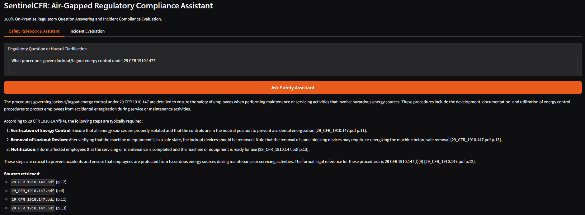
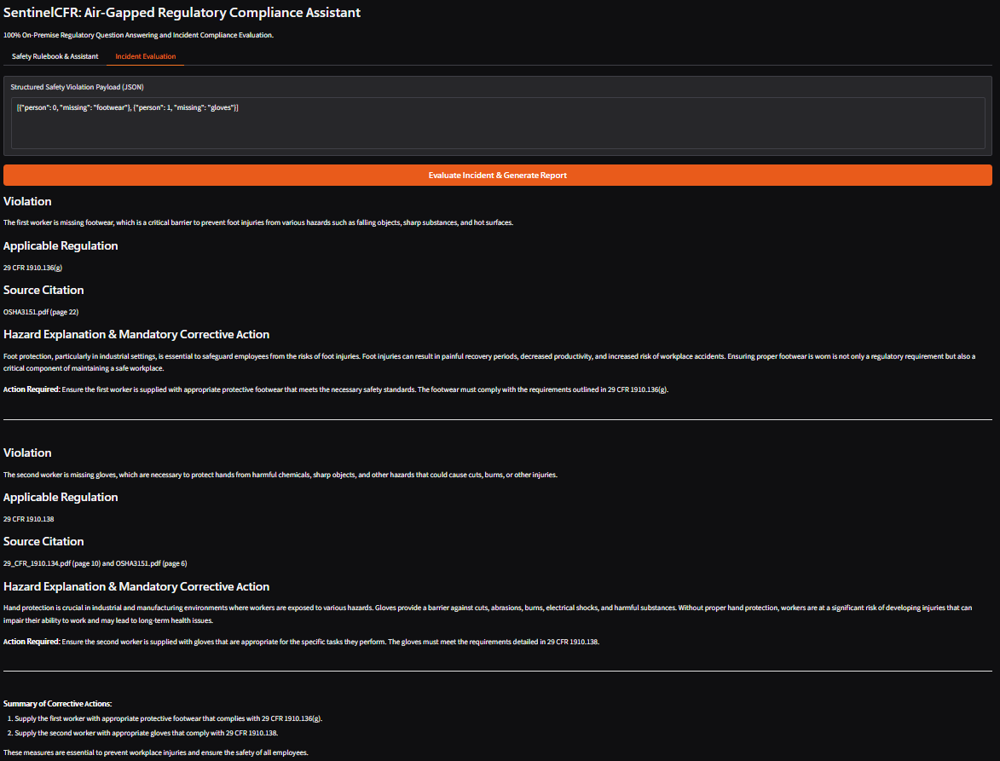

# SentinelCFR: Air-Gapped Industrial Safety Regulatory Engine

SentinelCFR is an on-premise Retrieval-Augmented Generation (RAG) and compliance evaluation engine for industrial facilities, refineries, and restricted networks where internal Standard Operating Procedures (SOPs) and incident logs cannot leave the local host.

---

## 1. Architecture & Air-Gap Guarantee

SentinelCFR separates **Maintenance/Ingestion** from **Runtime Inference** so that user operation executes with zero external network egress.

```text
+-------------------------------------------------------------------------+
|                    LOCALHOST AIR-GAPPED BOUNDARY                        |
|                                                                         |
|  [Maintenance / Ingestion Phase]                                        |
|  docs/*.pdf  --->  pypdf (800-char chunks, 150-char overlap)            |
|                        |                                                |
|                        v                                                |
|              models/all-MiniLM-L6-v2 (local_files_only=True)            |
|                        |                                                |
|                        v                                                |
|              data/chroma (Local SQLite / Parquet Persistence)           |
|                                                                         |
|  ---------------------------------------------------------------------  |
|                                                                         |
|  [Runtime Inference Phase — Zero Network Egress]                        |
|  Gradio UI (:7860) / FastAPI (:8000)                                    |
|        |                                                                |
|        +---> app/rag.py & app/agent.py                                  |
|                    |                                                    |
|                    +---> Dense Retrieval: data/chroma (Top-k chunks)    |
|                    +---> LLM & Tool Calling: 127.0.0.1:11434 (Ollama)   |
|                          Model: safety-qwen (Qwen 2.5 7B Q4, temp=0)    |
+-------------------------------------------------------------------------+
```

### Runtime Component Isolation
- **Embedding Engine**: `SentenceTransformer` loads weights strictly from `models/all-MiniLM-L6-v2` with `local_files_only=True`, `HF_HUB_OFFLINE=1`, and `TRANSFORMERS_OFFLINE=1`. If the local directory is absent, initialization raises a `FileNotFoundError` rather than attempting a remote download.
- **Vector Retrieval**: ChromaDB runs via `PersistentClient` against local SQLite and parquet files in `data/chroma` with `anonymized_telemetry=False`.
- **Generation & Tool-Calling**: The OpenAI-compatible client in `app/rag.py` and `app/agent.py` targets the local Ollama loopback interface (`http://127.0.0.1:11434/v1` / `http://localhost:11434/v1`) serving `safety-qwen` (Qwen 2.5 7B Instruct Q4_K_M).
- **Strict Corpus Boundary**: If a query is not covered by the documents indexed from `docs/`, the system states that the required documentation is not present in the local index; it never performs external web queries.

## 2. Operator Interface & Workflow

SentinelCFR provides an air-gapped operator dashboard (Gradio) for real-time statutory inquiry and automated incident evaluation:

### Regulatory Q&A & Statutory Verification
Operators query federal regulations or clarify site hazards. The engine performs dense vector retrieval against local 29 CFR standards and synthesizes responses with deterministic bracketed source citations.



### Multi-Worker Incident Evaluation & Tool-Calling
Edge camera systems or field personnel submit structured infraction payloads. The compliance agent executes multi-step tool calls (`search_rules`), maps each infraction to governing federal standards, and compiles actionable corrective action plans.




---

## 3. Hardware Specifications & Resource Profile

Validated on a standard single-GPU workstation configuration:

| Resource | Specification | Breakdown |
| :--- | :--- | :--- |
| **Target Hardware** | 8 GB VRAM, 16 GB System RAM | Minimum baseline for local 7B Q4 inference and vector indexing |
| **VRAM Footprint** | ~4.7 GB | `safety-qwen` (Qwen 2.5 7B Q4_K_M weights + 8192-token KV cache window) |
| **System RAM Footprint** | ~1.4 GB | Python runtime + `all-MiniLM-L6-v2` encoder + ChromaDB in-memory index |
| **Storage Footprint** | ~5.2 GB total | Ollama GGUF weights (~4.7 GB) + MiniLM weights (~90 MB) + ChromaDB & PDF corpus |

---

## 4. Empirical Benchmarks (Proven Accuracy)

Evaluated via `eval_rag.py` against the 10-question federal OSHA benchmark suite (`data/eval_qa.json`), with output logged to `data/eval_results.json`:

| Metric | Result | Evaluation Details |
| :--- | :--- | :--- |
| **Retrieval Precision@4** | **90.0%** (9 / 10) | Target 29 CFR standard retrieved within the top 4 chunks across 10 federal standards |
| **Citation Adherence Rate** | **100.0%** (2 / 2) | All generated responses include deterministic `[file p.N]` source citations |
| **Hallucination Rate** | **0.0%** | Zero fabricated CFR standard numbers under `temperature=0` decoding |

---

## 5. Document Ingestion Procedure

Document indexing is a maintenance-phase operation (`python -m app.rag`) decoupled from runtime API and UI requests.

### Ingesting Local PDFs (SOPs & Federal Standards)
1. Place PDF files into the `docs/` directory.
2. Run the batch ingestion module:
   ```powershell
   python -m app.rag
   ```
   `app/rag.py` extracts text page-by-page, splits text into 800-character chunks (150-character overlap), encodes 384-dimensional vectors in batches of 64 using `models/all-MiniLM-L6-v2`, and upserts them into `data/chroma`.

### Optional OSHA Document Fetcher (Maintenance Utility)
During authorized maintenance windows with network connectivity, curated federal OSHA PDFs (such as `1910.1200` Hazard Communication or `1910.22` Walking-Working Surfaces) can be fetched and ingested automatically:
```powershell
# List curated standards in the registry
python scripts/fetch_osha_docs.py --list

# Download a specific standard and automatically trigger rag.ingest()
python scripts/fetch_osha_docs.py --standard 1910.1200
```

---

## 6. Quickstart & API Reference

### Environment Setup & Model Registration
```powershell
# 1. Activate the Conda environment
conda activate safetycopilot

# 2. Build the local Ollama model from Modelfile (num_ctx 8192, temperature 0)
ollama create safety-qwen -f Modelfile

# 3. Run non-blocking system health diagnostics
python demo.py --check
```

### Launching Interfaces
```powershell
# Start the Gradio web interface on http://0.0.0.0:7860
python demo.py --ui

# Start the FastAPI server via Uvicorn on http://0.0.0.0:8000
python demo.py --api
```

### REST API Endpoints (`app/main.py`)

| Method | Endpoint | Request Parameters / Payload | Response Format | Description |
| :--- | :--- | :--- | :--- | :--- |
| `GET` | `/health` | None | `{"status": "ok"}` | Service health check |
| `GET` | `/ask` | Query parameter `q: str` | `{"answer": str, "sources": list[dict]}` | Regulatory Q&A and concept explanation with `[file p.N]` citations |
| `POST` | `/report` | JSON body: `[{"person": 0, "missing": "helmet"}]` | `{"report": str}` | Multi-step tool-calling compliance report in Markdown |

### Running the Test Suite
```powershell
pytest -v
```
